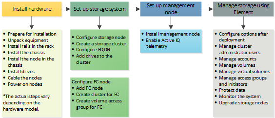

= 了解如何设置存储
:allow-uri-read: 
:icons: font
:imagesdir: ../media/

[role="lead"]
此时，您应已安装硬件。此硬件还包括 Element 软件。

接下来，您需要为您的环境设置存储系统。您可以使用存储节点或光纤通道节点设置集群，并在机架单元中安装节点并为其布线并打开电源后使用 Element 软件对其进行管理。

.设置存储的步骤
. 选择以下选项之一：
+
** link:../setup/concept_setup_configure_a_storage_node.html["使用存储节点设置集群"]
+
在机架单元中安装节点并为其布线并打开电源后，您可以使用 Element 软件设置包含存储节点的集群并对其进行管理。然后，您可以在存储系统中安装和配置其他组件。

** link:../setup/concept_setup_fc_configure_a_fibre_channel_node.html["设置具有光纤通道节点的集群"]
+
在机架单元中安装并连接光纤通道节点并通电后，您可以使用 Element 软件设置一个包含光纤通道节点的集群并对其进行管理。然后，您可以安装和配置存储系统中的其他组件。

. link:../setup/task_setup_determine_which_solidfire_components_to_install.html["确定要安装的 SolidFire 组件"]
. link:../setup/task_setup_gh_redirect_set_up_a_management_node.html["设置管理节点并启用 Active IQ 遥测"]

[[find-more-information]]
== 了解更多信息

* link:../setup/concept_setup_whats_next.html["了解使用存储的后续步骤"]
* https://docs.netapp.com/us-en/element-software/index.html["SolidFire 和 Element 软件文档"]

