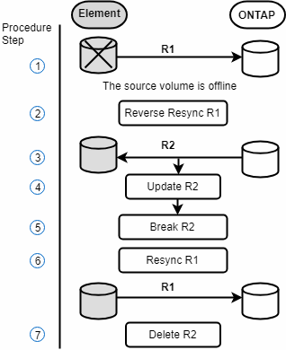
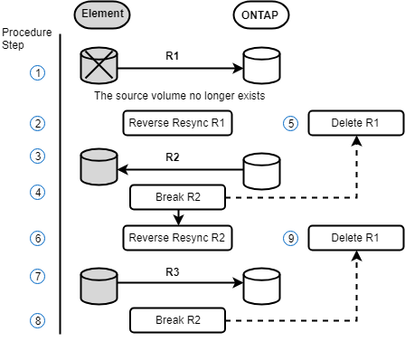

= 了解如何执行故障恢复到 Element 模式
:allow-uri-read: 
:icons: font
:imagesdir: ../media/

[role="lead"]
缓解主端的问题描述后，您必须重新同步原始源卷并故障恢复到 NetApp Element 软件。根据原始源卷是否仍然存在或是否需要故障恢复到新创建的卷，您执行的步骤会有所不同。

== SnapMirror 故障恢复场景

SnapMirror 灾难恢复功能在两种故障恢复情形中进行了说明。假定原始关系已进行故障转移（已中断）。

添加了相应过程中的步骤以供参考。

NOTE: 在此处的示例中， R1 表示原始关系，其中运行 NetApp Element 软件的集群是原始源卷（ Element ），而 ONTAP 是原始目标卷（ ONTAP ）。R2 和 R3 表示通过反向重新同步操作创建的反向关系。

下图显示了源卷仍存在时的故障恢复场景：

下图显示了源卷不再存在时的故障恢复场景：

== 了解更多信息

* xref:task_snapmirror_perform_failback_when_source_volume_exists.adoc[如果源卷仍存在，请执行故障恢复]
* xref:task_snapmirror_performing_failback_when_source_volume_no_longer_exists.adoc[源卷不再存在时执行故障恢复]
* xref:concept_snapmirror_failback_scenarios.adoc[SnapMirror 故障恢复场景]

